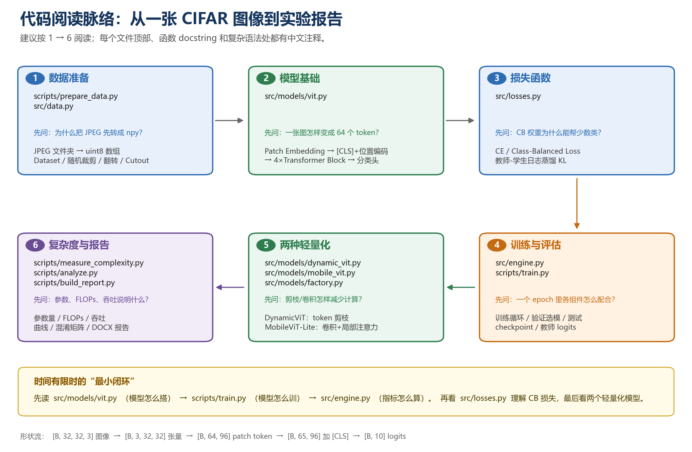

# CIFAR-10 类别不均衡 ViT 实验

本目录是课程实验的完整代码与结果，包含：

- 从零实现的 Vision Transformer（ViT）基线；
- 类别不均衡处理：Class-Balanced Loss（基于有效样本数）；
- 两种结构级轻量化方法：DynamicViT 渐进 token 剪枝、MobileViT-Lite 卷积—Transformer 混合结构；
- 参数量、FLOPs、单张延迟、批吞吐的测量脚本；
- 训练曲线、混淆矩阵、单类召回、复杂度—精度权衡图；
- 中文实验报告（DOCX / PDF）；
- 面向初学者的代码阅读脉络图和逐文件中文注释。

## 代码阅读脉络

建议按“数据 → 模型 → 损失 → 训练 → 轻量化 → 复杂度与报告”的顺序阅读。时间有限时，先读
`src/models/vit.py`（模型怎么搭）→ `scripts/train.py`（模型怎么训）→ `src/engine.py`（指标怎么算）。



更详细的阅读顺序、每个文件要回答的问题、Mermaid 依赖图和初学者语法清单见
[`docs/代码阅读指南.md`](docs/代码阅读指南.md)。代码的每个文件顶部、函数 docstring、复杂语法处均有中文注释。

## 目录结构

```
vit_cifar10_lab/
├── src/
│   ├── data.py                 # 数据读取、uint8 缓存、batch 增广
│   ├── engine.py               # 训练/评估循环、指标、参数量
│   ├── losses.py               # CE、CB Loss、有效样本数权重、蒸馏
│   └── models/
│       ├── vit.py              # ViT 基线
│       ├── dynamic_vit.py      # DynamicViT token 剪枝
│       ├── mobile_vit.py       # MobileViT-Lite
│       └── factory.py          # 配置构建模型
├── scripts/
│   ├── prepare_data.py         # JPEG 文件夹 -> npy
│   ├── train.py                # 单模型训练与测试
│   ├── measure_complexity.py   # 参数量/FLOPs/延迟/吞吐
│   ├── dynamic_tokens.py       # 记录剪枝各阶段 token 数
│   ├── analyze.py              # 汇总表与图
│   ├── make_architecture_figure.py
│   ├── make_code_roadmap.py    # 生成代码阅读脉络图
│   └── build_report.py         # 生成 DOCX 报告
├── docs/
│   └── 代码阅读指南.md          # 阅读顺序、依赖图、语法清单
├── tests/
│   └── test_smoke.py           # 不依赖数据集的模型形状/损失单元测试
├── data/                       # 预处理后的 npy（不提交大文件时可删除）
├── checkpoints/                # 最佳模型与教师 logits
├── results/                    # 每个实验的 JSON/日志/汇总
├── figures/                    # 报告插图
└── report/                     # 实验报告 DOCX / PDF
```

## 环境

- Python 3.13
- PyTorch 2.12（CPU 版即可，实验在无 GPU 环境完成）
- NumPy、pandas、Matplotlib、Pillow、python-docx

安装：

```bash
pip install -r requirements.txt
```

## 数据

将课程附件放在本目录的上一级（默认 `D:\claude-code\ViT`），即：

```
ViT/
├── CIFAR10_imbalanced.zip
├── CIFAR10_unbalance/0..9/
└── CIFAR10_balanced/CIFAR10_balance/0..9/
```

然后执行：

```bash
python scripts/prepare_data.py
```

脚本会生成 `data/train_images.npy`、`data/train_labels.npy`、`data/test_images.npy`、
`data/test_labels.npy` 和 `data/meta.json`。训练集 35,580 张，测试集 4,870 张。

## 训练

```bash
# 基线（普通交叉熵）
python scripts/train.py --model vit --loss ce --tag baseline_ce --epochs 20 --save-predictions

# 基线 + CB Loss
python scripts/train.py --model vit --loss cb --tag baseline_cb --epochs 20 --export-logits --save-predictions

# DynamicViT（用 CB 教师蒸馏）
python scripts/train.py --model dynamic --loss cb --tag dynamic_cb --epochs 20 \
  --prune-after 0,1,2 --keep-ratios 0.75,0.5,0.25 \
  --distill-logits checkpoints/baseline_cb_train_logits.pt --save-predictions

# MobileViT-Lite（用 CB 教师蒸馏）
python scripts/train.py --model mobile --loss cb --tag mobile_cb --epochs 20 \
  --dim 72 --mobile-depth 2 --global-depth 1 --mobile-patch 4 \
  --distill-logits checkpoints/baseline_cb_train_logits.pt --save-predictions
```

训练脚本默认 8 线程、batch 128、AdamW、余弦退火、20 epoch；从训练集分层抽取 10% 作为验证集，
按验证集准确率保存最佳 checkpoint，测试集只在最后评估一次。每个 epoch 会保存
`checkpoints/<tag>_last.pt`，若中断可用 `--resume checkpoints/<tag>_last.pt` 继续。
也可以运行 `scripts/run_all.ps1` 一次完成全部流程。

## 复杂度与图表

```bash
python scripts/measure_complexity.py --threads 8
python scripts/dynamic_tokens.py
python scripts/analyze.py
python scripts/build_report.py
```

- `measure_complexity.py` 使用 `torch.utils.flop_counter.FlopCounterMode` 统计前向 FLOPs，
  并测量 batch=64 吞吐；单张延迟受 CPU 调度影响大，仅作参考。
- `analyze.py` 生成 `results/summary.csv`、`results/summary.md` 和 `figures/*.png`。
- `build_report.py` 读取所有结果并生成 `report/CIFAR10_ViT实验报告.docx`。

## 主要结果

在均衡测试集（4,870 张）上的结果如下；FLOPs 为单张前向，吞吐为 CPU、8 线程、batch=64：

| 模型 | 参数量(M) | FLOPs(G) | 准确率(%) | 宏平均F1(%) | 吞吐(img/s) |
|---|---:|---:|---:|---:|---:|
| ViT + CE | 0.311 | 0.045 | 64.93 | 64.78 | 2345 |
| ViT + CB | 0.311 | 0.045 | 66.30 | 66.17 | 2332 |
| DynamicViT + CB | 0.326 | 0.026 | 64.33 | 64.11 | 3360 |
| MobileViT-Lite + CB | 0.159 | 0.021 | 67.80 | 67.50 | 2754 |

- CB 损失使总体准确率提高约 1.4 个百分点；卡车召回从 57.3% 提升到 71.9%，汽车召回从 82.1% 降到 76.8%。
- DynamicViT 将 FLOPs 降低 42.3%、吞吐提高 44.0%，参数量增加 4.7%，准确率下降 2.0 个百分点。
- MobileViT-Lite 将参数量降低 49.1%、FLOPs 降低 53.1%，准确率反而提高 1.5 个百分点，吞吐提高 18.1%。

完整表格、混淆矩阵、训练曲线和误差分析见 `report/CIFAR10_ViT实验报告.docx`（或 PDF）。

## 说明

- 所有模型共享同一数据划分（seed=42）和同一测试集，保证可比。
- DynamicViT 在 Block 1/2/3 后按 75%/50%/25% 保留 patch token，推理时真实丢弃 token；
  因此 FLOPs 的下降来自实际计算路径变短，而不是掩码。
- MobileViT-Lite 使用卷积 stem、2 个 MobileViT Block（patch 内 4×4 注意力）和 1 个全局
  Transformer Block，属于结构级改动，不是简单调小维度/层数。
- 实验在 CPU 上完成，速度结论只适用于相同硬件与线程设置；FLOPs 不等同于实际延迟。
- 单张延迟受 CPU 调度噪声影响大，报告以 batch=64 吞吐作为主要推理速度指标。
