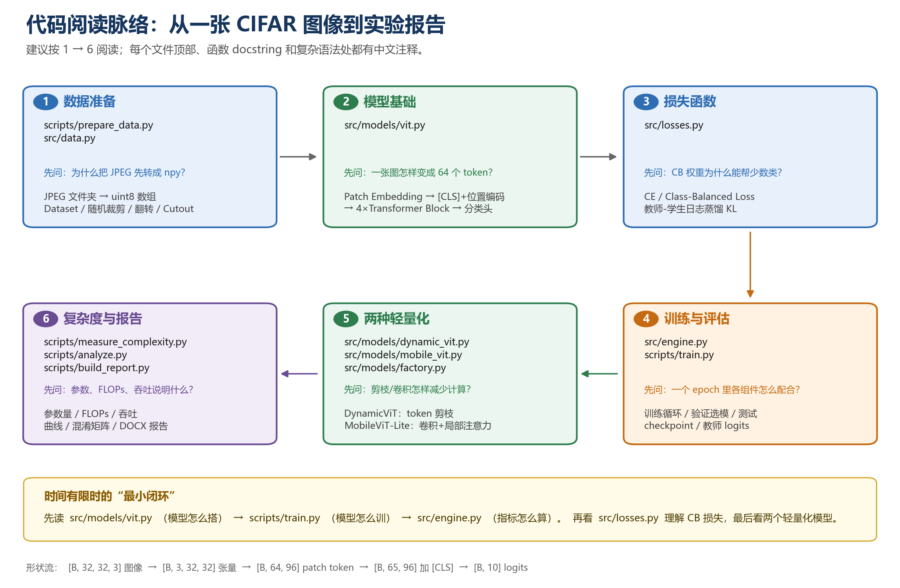
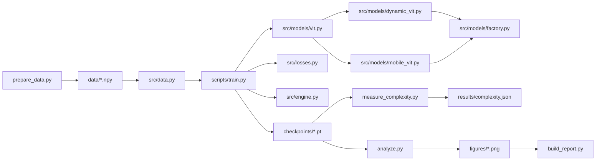

# 代码阅读指南（初学者版）

这张图和这份指南解决一个问题：**面对一个完整的深度学习项目，应该按什么顺序读，读到每个文件时先弄懂什么。**



## 1. 先建立“最小闭环”

如果时间有限，先读这三个文件，把“模型怎么搭、怎么训、指标怎么算”串起来：

1. `src/models/vit.py`：一张 32×32 的图怎样变成 64 个 patch token，再经过 4 个 Transformer Block 得到 10 类 logits。
2. `scripts/train.py`：数据怎样装入 DataLoader、一个 epoch 怎样循环、验证集怎样选模型、checkpoint 怎样保存。
3. `src/engine.py`：训练一个 step 里 `zero_grad → forward → loss → backward → clip → step → scheduler.step` 的顺序，以及准确率 / 宏平均 F1 / 混淆矩阵怎样算。

读完这三个文件，再去看 `src/losses.py` 的 CB 损失和两个轻量化模型，就不会被“token 剪枝”“patch 内注意力”这些新名词打断主线。

## 2. 推荐阅读顺序

| 顺序 | 文件 | 读之前先问自己 | 读完后应该能回答 |
|---|---|---|---|
| 1 | `scripts/prepare_data.py`、`src/data.py` | 原始数据长什么样？为什么要先转成 npy？ | JPEG 文件夹怎样变成 `[N,32,32,3]` 的 uint8 数组；Dataset 的 `__getitem__` 返回什么。 |
| 2 | `src/models/vit.py` | 一张图怎样变成 token？ | Patch Embedding、[CLS]、位置编码、多头注意力、Pre-LN、残差、分类头的形状变化。 |
| 3 | `src/losses.py` | 不均衡为什么会让模型偏向多数类？ | CE、CB 的有效样本数公式、类别权重、标签平滑、蒸馏 KL。 |
| 4 | `src/engine.py` | 一个训练 step 里谁先谁后？ | 训练循环、梯度裁剪、学习率调度、评估指标、ECE 的计算。 |
| 5 | `scripts/train.py` | 一个完整实验怎样组织？ | 分层划分、DataLoader、验证选模、checkpoint、教师 logits 导出。 |
| 6 | `src/models/dynamic_vit.py` | 剪枝为什么能省 FLOPs？ | token 打分、Gumbel top-k、直通估计器、65→49→25→7 的 schedule。 |
| 7 | `src/models/mobile_vit.py` | 卷积和注意力怎样混合？ | 卷积 stem、`F.unfold/F.fold`、patch 内注意力、全局 Block。 |
| 8 | `scripts/measure_complexity.py`、`scripts/analyze.py` | 参数量、FLOPs、吞吐分别说明什么？ | `FlopCounterMode`、warm-up、median、吞吐换算、混淆矩阵和权衡图。 |

`scripts/build_report.py` 是“把结果排版成 DOCX”的辅助脚本，不参与模型计算，可以最后看；`src/models/factory.py` 只是按字符串创建模型，适合在读完三个模型文件后看。

## 3. 依赖关系（Mermaid）



## 4. 读代码时抓住“形状流”

深度学习代码最容易迷路的地方是张量形状。建议在草稿纸上跟着下面这条线走：

```text
原始图像        [B, 32, 32, 3]       B = batch size
转成 PyTorch    [B, 3, 32, 32]       channel first
Patch Embedding [B, 64, 96]          4×4 patch，64 个 token，96 维
拼接 [CLS]      [B, 65, 96]          1 个分类 token + 64 个 patch token
Transformer ×4  [B, 65, 96]          形状不变，内容被反复更新
取 [CLS]        [B, 96]
分类头          [B, 10]              10 类 logits
```

DynamicViT 在 Block 1/2/3 后把 65 个 token 依次剪成 49、25、7；MobileViT-Lite 先把 32×32 降到 8×8，再在 4×4 的 patch 内部做注意力。

## 5. 初学者容易卡住的语法

代码里已经用中文注释标出，这里列一个“查字典”清单：

- `@torch.no_grad()`：关闭梯度记录，评估/推理时省内存。
- `model.train()` / `model.eval()`：切换 Dropout、BatchNorm、DropPath 的行为，**不会**自动关闭梯度。
- `optimizer.zero_grad(set_to_none=True)`：清空上一步梯度，`set_to_none` 更省内存。
- `loss.backward()`：反向传播，计算每个参数的梯度。
- `scheduler.step()`：更新学习率，通常放在 `optimizer.step()` 之后。
- `x.detach()`：从计算图里切断，只保留数值，不传梯度。
- `torch.gather`：按索引从张量里“挑”元素；DynamicViT 用它保留 top-k token。
- `F.unfold` / `F.fold`：把二维特征图展开成 patch 序列 / 再折叠回去，是 MobileViT 的核心。
- `register_buffer`：注册不需要训练、但要跟着模型保存/搬设备的张量（例如 CB 的类别权重）。
- `@dataclass`：自动生成 `__init__`，用来集中存放超参数。
- `**kwargs`：把任意关键字参数打包成字典，`factory.py` 用它兼容命令行配置。

## 6. 建议的动手方式

1. 先运行 `python -m unittest discover -s tests -v`，确认环境和模型结构没问题。
2. 在 `src/models/vit.py` 的 `forward_features` 里打一个断点，观察 `x.shape` 从 `[B,3,32,32]` 到 `[B,65,96]`。
3. 在 `scripts/train.py` 的一个 epoch 里打印 `images.shape`、`logits.shape`、`loss`。
4. 只改一个变量做对照（例如把 `--loss ce` 改成 `--loss cb`），观察 `results/*.json` 中哪些指标变了。
5. 最后再读 `measure_complexity.py` 和 `analyze.py`，理解“精度—参数量—FLOPs—吞吐”四张表是怎样汇总的。

> 读代码的目标不是记住每一行，而是能画出“数据从哪来、经过哪些函数、变成什么、在哪里被评估”的路线。这张图和这份指南就是这条路线。
